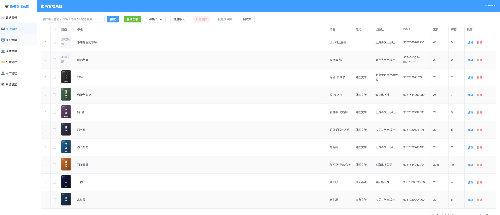
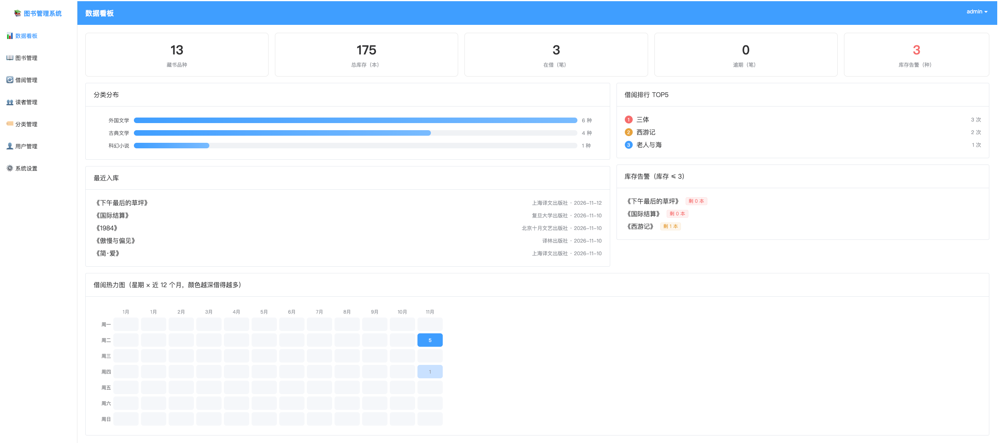

# 图书管理系统（FastAPI + Vue3）

## 界面预览

**图书管理** —— 封面、搜索、批量操作、回收站：

**数据看板** —— 统计卡片、分类分布、借阅排行、借阅热力图：

## 功能列表

### 图书管理
- 图书增删改查，29 个字段：副标题、原作名、译者、ISBN、丛书、语种、出版地、出版日期、版次、装帧、开本、页数、定价、标签、内容简介、作者简介、目录、条形码、索书号、馆藏位置、来源、封面等
- 封面上传（本地存储，5MB 限制）；ISBN 一键在线查询，自动回填出版信息（豆瓣数据源，带超时保护）
- Excel 批量导入 / 导出
- 批量删除、批量改分类；有在借记录的书不允许删除
- 回收站：删除先进回收站（软删除），可恢复或彻底删除
- 多字段搜索（书名 / 作者 / ISBN / 分类 / 标签等）+ 分页

### 借阅管理
- 借出 / 归还 / 续借 / 删除记录；借出自动减库存，归还自动恢复
- 借出前双重校验：库存是否充足、读者是否已达可借上限
- 续借每笔限一次，顺延天数由系统设置控制
- 逾期动态判定：在借且超过应还日期自动标记「逾期」，无需定时任务
- 状态筛选（全部 / 在借 / 逾期 / 已还）+ 书名 / 借阅人搜索
- 记录书名、借阅人姓名快照，书或读者删除后历史记录仍完整可读

### 读者管理
- 读者档案增删改查，证号留空自动生成（R0001 格式）
- 每位读者可单独设可借上限，不填则用系统默认值
- 有在借记录的读者不允许删除

### 分类管理
- 分类字典统一维护，避免图书分类拼写五花八门
- 重命名自动同步所有图书；有书在用的分类禁止删除

### 用户管理
- 账号增删改查，仅管理员可操作
- 保护机制：不能删除自己、最后一个管理员不能被降级或删除
- 修改自己的密码（需验证原密码）

### 数据看板
- 统计卡片：藏书品种 / 总库存 / 在借 / 逾期 / 库存告警
- 分类分布条形图、借阅排行 TOP5、最近入库、库存告警列表（库存 ≤ 3）
- 借阅热力图：星期 × 近 12 个月的借阅量，颜色越深借得越多

### 系统设置
- 默认借期、续借顺延天数、逾期日罚金（罚款功能预留）、新读者默认可借上限
- 存在数据库里，管理员在线修改，全站立即生效，无需改代码重启

### 基础能力
- JWT 登录认证 + bcrypt 密码加密；全部接口需登录，改设置等敏感操作仅限管理员
- 启动时自动建表、自动补缺失字段、自动初始化管理员 / 分类 / 默认设置
- 自动生成的接口文档：http://127.0.0.1:8000/docs

## 后端
cd backend
python -m venv venv
venv\Scripts\activate        (macOS/Linux: source venv/bin/activate)
pip install -r requirements.txt
uvicorn app.main:app --reload --port 8000

接口文档: http://127.0.0.1:8000/docs
默认管理员: admin / admin123（可在 backend/.env 中修改）

## 前端
cd frontend
npm install
npm run dev

访问: http://localhost:5173

## 数据库
请先在 MySQL 中创建数据库:
CREATE DATABASE IF NOT EXISTS myBigBig DEFAULT CHARACTER SET utf8mb4 COLLATE utf8mb4_unicode_ci;
表结构在后端启动时自动创建。
